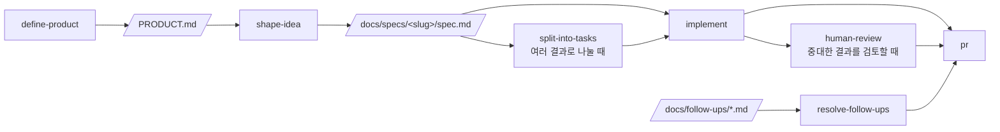

# Claude Code Playbook Template

[](https://www.claude-hunt.com)
[](https://docs.claude-hunt.com)

> [Claude Hunt](https://www.claude-hunt.com) 강의용 Next.js 16 + React 19 템플릿.
> 사용법과 워크플로우 문서는 [docs.claude-hunt.com](https://docs.claude-hunt.com)에서 확인하세요.

## 기술 스택

Next.js 16 (App Router) · React 19 · Tailwind CSS 4 · shadcn/ui · Bun · Vitest · Playwright

## 시작하기

```bash
bun install
bun dev
```

[http://localhost:3000](http://localhost:3000)에서 결과를 확인할 수 있습니다.

## 사무실 화면

Claude Code 세션의 tool · skill · sub-agent 호출을 사무실 속 캐릭터로 보여줍니다.

1. 이 프로젝트에서 사무실 서버를 켭니다.

   ```bash
   bun run office
   ```

2. 보고 싶은 Claude Code 세션에서 `/office`를 실행합니다. 연결을 끊으려면 `/office close`를 실행합니다.
3. http://127.0.0.1:4747 을 엽니다. 같은 저장소에서 연 세션은 워크트리가 달라도 한 사무실에 함께 보입니다.

hook은 [.claude/settings.json](.claude/settings.json)에 있으며 4747번 포트로 이벤트를 보냅니다. 그래서 `bun dev`(3000번)로 띄운 개발 서버에는 실제 세션의 이벤트가 오지 않습니다.

### Codex 연결 실험

Codex CLI와 ChatGPT 데스크톱 앱의 Codex 세션도 연결할 수 있습니다(Codex 0.167에서 확인). 일반 ChatGPT 대화는 hook이 없어 연결할 수 없습니다. 실제 세션에서 연결·해제, 도구 실행, 허용 요청, 턴 종료를 확인했고, sub-agent와 작업 게시판은 아직 보여주지 않습니다.

- 승인 검토자가 자동 검토(auto review)인 세션의 허용 요청은 사람을 기다리지 않으므로 허용 대기로 보이지 않습니다.
- `PostToolUse`를 받지 못해도 기록에 `completed`·`failed`가 있으면 실행된 호출로 정리합니다. 명시적인 Esc 중단 뒤의 `completed`·`failed`는 중단 전에 완료됐다는 시각이 확인될 때만 완료로 보정합니다. 이 화면의 허용됨은 실행 허용을 뜻하며, 명령 성공·실패는 원래 앱에서 확인합니다.
- 거절은 `declined` 실행 항목 또는 코드 모드의 실제 거절 오류로 알아냅니다. 정적인 셸 호출 하나와 `Promise.allSettled([...])`의 개별 결과를 해석합니다. `text(results)`, 결과를 순서대로 출력하는 `for...of`·`forEach`·인덱스 `for`를 지원하며, 결과에 순번만 덧붙인 `{part:i, ...result}`도 읽습니다. 다른 직접 도구 호출이 섞여 있어도 배열 위치를 보존합니다. `acorn`으로 구문만 분석하며 기록의 코드를 실행하지 않습니다.
- 코드 모드 거절은 턴·명령·시간 범위가 맞고, 해당 캐릭터가 다른 동시 코드 호출에 속할 가능성이 없을 때만 반영합니다. 같은 명령의 복수 후보, 동적 코드, 결과를 변형한 배열, 실패한 명령을 구분할 결과가 없는 여러 순차 호출은 보류합니다. 배열의 거절 항목은 각각 한 번만 반영합니다.
- 실제 Codex 0.167의 `PreToolUse`·`PermissionRequest` hook과 native `decline` 응답, 기록 감시를 거쳐 단일 호출·병렬 호출의 거절 표시를 확인했습니다. CLI 허용 창의 `No`는 Codex가 `aborted by user`와 `Interrupt`로 기록하므로 화면에서도 중단으로 유지합니다. 실행 거절(`declined`)과 같은 기록이 아닙니다.
- 기록 파일을 감시해 다음 hook 없이도 거절을 반영합니다. PreToolUse를 놓친 셸 호출은 같은 턴의 명령으로 ID를 복구합니다. 턴 종료 뒤 남아 있는 퇴근 캐릭터도 거절로 보정하며, SessionEnd 뒤에는 8초 동안 추가로 감시합니다. 실행 항목으로 ID를 복구할 때는 명령·턴 ID·완료 시각이 있어야 하고 완료 시각이 대기 시작 이후여야 합니다. 같은 입력의 허용 요청은 기존 중복 방지 규칙에 따라 하나로 합쳐질 수 있습니다.

1. `bun run office`로 서버를 켭니다.
2. 이 저장소를 연 Codex에서 `.codex/hooks.json`의 hook을 검토하고 신뢰합니다. CLI에서는 `/hooks`, 데스크톱에서는 hook 검토 화면을 사용합니다. 설정이 반영되지 않았다면 새 세션에서 확인합니다.
3. 연결할 Codex 세션에서 `bun run office:codex connect`를 샌드박스 밖에서 실행하도록 요청합니다. Codex 샌드박스는 127.0.0.1로 나가는 연결도 막으므로 권한 상승 승인이 한 번 필요합니다(hook은 샌드박스 밖에서 돌아 영향이 없습니다). 현재 세션의 `CODEX_THREAD_ID`를 사용하며 이후 활동이 사무실에 표시됩니다.
4. 연결을 끊으려면 같은 세션에서 `bun run office:codex close`를 실행합니다.

hook은 명령으로 JSON 입력을 받아 로컬 서버에 전달합니다. 전송 실패가 Codex의 실행·허용 결정을 막지 않도록 응답하며, 원본 이벤트는 로컬 `/api/events`에서 확인할 수 있습니다. Codex transcript는 Claude 기록 해석기에 전달하지 않습니다. 서버를 다시 켜면 연결 명령도 다시 실행해야 합니다.

검증용 서버 주소는 `OFFICE_CODEX_URL=http://127.0.0.1:4749/api/events`처럼 바꿀 수 있습니다. 로컬 HTTP 주소만 허용합니다. hook 설정과 이벤트 형식의 기준은 [공식 Hooks 문서](https://learn.chatgpt.com/docs/hooks)입니다.

## 스크립트

| 명령어 | 설명 |
|---|---|
| `bun dev` | 개발 서버 실행 (http://localhost:3000) |
| `bun run office` | 사무실 서버 실행 (http://127.0.0.1:4747, hook이 이벤트를 보내는 주소) |
| `bun run build` | 프로덕션 빌드 |
| `bun start` | 프로덕션 서버 실행 |
| `bun run lint` | ESLint 실행 |
| `bun run typecheck` | `tsc --noEmit` 타입 검사 |
| `bun run test` | Vitest 단위/컴포넌트 테스트 1회 실행 |
| `bun run test:watch` | Vitest watch 모드 |
| `bun run test:e2e` | Playwright E2E 테스트 실행 |

## 테스트

- **단위·컴포넌트**: Vitest + Testing Library. 설정은 `vitest.config.mts`, 매처와 cleanup은 `vitest.setup.ts`에 있습니다. 테스트 파일은 소스 옆에 `*.test.ts(x)`로 둡니다(`app/page.test.tsx`, `lib/utils.test.ts` 참고). `globals`를 켜지 않았으므로 `describe`/`it`/`expect`는 `vitest`에서 import 합니다.
- **E2E**: Playwright. 설정은 `playwright.config.ts`, 테스트는 `e2e/*.spec.ts`에 둡니다. `webServer`가 `bun run dev`를 자동으로 띄우므로 별도 서버 실행이 필요 없습니다.

E2E를 처음 실행하기 전에 브라우저를 한 번 내려받아야 합니다.

```bash
bunx playwright install chromium
```

브라우저가 이미 설치된 환경(예: Claude Code 원격 세션)에서는 내려받는 대신 실행 파일 경로를 지정할 수 있습니다.

```bash
PLAYWRIGHT_CHROMIUM_PATH=/opt/pw-browsers/chromium bun run test:e2e
```

`async` Server Component는 Vitest가 아직 지원하지 않으므로 E2E로 검증합니다.

- **런타임 검증(에이전트용)**: [agent-browser](https://github.com/vercel-labs/agent-browser). 에이전트가 `next-dev-loop` 스킬로 실행 중인 앱을 직접 조작해 변경을 확인할 때 씁니다. 프로젝트 의존성이 아니므로 한 번 전역으로 설치합니다.

```bash
npm i -g agent-browser
agent-browser install  # 설치된 Chrome이 없을 때만
```

## Claude Code 워크플로우



파이프라인 밖에서는 `project-knowledge`, `maintain-project-context`, `add-stack-context`, `build-prototype`, `explain-visually`, `tdd`가 각자의 조건에 따라 켜집니다. `project-knowledge`는 `GLOSSARY.md`, `docs/decisions/`, `docs/follow-ups/`에 다음 작업에서도 재사용할 지식과 후속 항목을 남깁니다. Git 작업은 `commit`, `pull`, `push`, `pr`, `merge`가 해당 요청에 맞춰 처리합니다.
